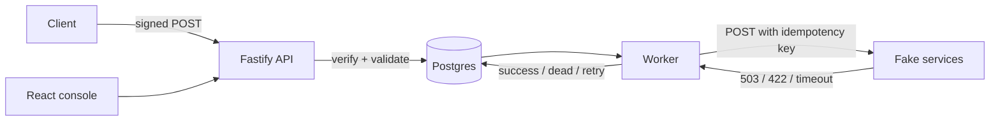

# Architecture

1. The webhook body is read as raw text, so the HMAC covers exactly what was sent.
2. A timestamp more than 5 minutes away from now is rejected, which limits replay of captured
   requests even when the signature is valid.
3. The event is inserted with a unique `(source, external_id)` constraint. A duplicate delivery
   returns the existing execution instead of creating a second business action.
4. An execution row is created in `queued` state before any destination is called.
5. The worker claims due executions with `FOR UPDATE SKIP LOCKED`, so two workers never run the same
   execution.
6. Steps are persisted individually. A retry skips the steps that already succeeded.
7. Transient failures (5xx, 408, 429, timeout) schedule a retry with exponential backoff and full
   jitter. Permanent failures (4xx) mark the execution dead immediately.
8. Replay creates a new execution for the stored event, so history is preserved.
