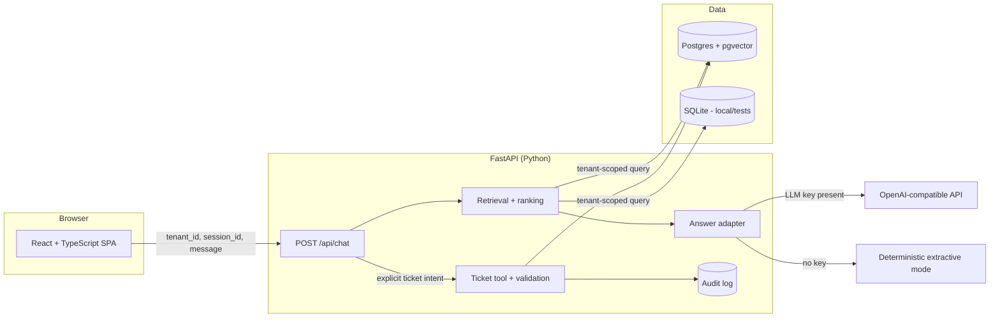

# Architecture

**Personal demo project.** Northstar Agent is a support agent for a fictional company. It answers
from a small knowledge base, cites the document and excerpt it used, abstains when the evidence is
missing, and can open a fictional ticket through one audited tool.

## Components

One process serves the API and the built SPA. Postgres + pgvector is the deployment store; SQLite
keeps local development and the test suite dependency-free. Both go through the same small
`Connection` wrapper in `backend/app/core.py`.

## Request flow

1. `POST /api/chat` validates the payload (Pydantic) and checks the tenant against the `tenants`
   table. An unknown tenant is a `404`, before any model or retrieval work.
2. Retrieval runs a tenant-filtered query. On Postgres the candidate set comes from pgvector's
   cosine-distance ordering (`embedding <=> query::vector`, top 40); SQLite scans the tenant's
   chunks. Both then apply the same lexical gate and rerank in Python.
3. Ranking is a fixed blend, `0.7 * lexical_overlap + 0.3 * cosine`, so an unrelated but
   vector-similar document cannot win on embedding noise alone. Chunks below `0.18` lexical overlap
   are discarded.
4. A query that contains an unknown key term and fewer than two known terms is treated as
   unanswerable. This is what makes the abstention realistic rather than accidental.
5. Duplicate topics ("Warranty policy (updated)" vs "Warranty policy (2024, outdated)") collapse to
   the newest document, so a stale policy cannot answer a current question.
6. The answer adapter either calls the configured LLM with the retrieved documents as untrusted
   context, or extracts the best-matching sentences deterministically. The mode is returned in every
   response (`deterministic`, `openai`, `tool`, `abstain`).
7. Citations are attached only for the documents that actually contributed to the answer. An aborted
   or unrelated retrieval yields no citations.
8. A ticket request is handled by code, not by the model: intent detection triggers the tool, the
   arguments are validated, and both the sanitized arguments and the result are written to the audit
   table.

## Trust boundaries

| Boundary | Control |
|---|---|
| Tenant data | Tenant filter is part of every retrieval query. A cross-tenant prompt returns no citations and abstains. |
| Documents as content | Retrieved text is wrapped as data. Sentences containing injection markers are dropped before extraction; the system prompt tells the model to treat document text as data. |
| Tool authority | The model cannot call tools directly. Code decides when the tool runs, validates subject/description/priority, and rejects invalid arguments with an audit entry. |
| Secrets in logs | Argument keys matching token/password/secret/key/authorization are replaced with `[redacted]` before being stored. |
| Admin ingestion | Disabled unless `ADMIN_TOKEN` is set; requires the header and an existing tenant. |
| Conversation history | Queries are scoped by `tenant_id` **and** `session_id`; the history endpoint returns nothing across either boundary. |

## Data model

- `tenants` — fictional workspaces.
- `documents` — title, source path, `updated_at` (basic versioning), content.
- `chunks` — document slices with embeddings (256-dim hashing embedding in the demo).
- `messages` — session-scoped conversation, used as limited LLM context.
- `tickets` — fictional tickets created by the tool.
- `audit` — every tool invocation: action, sanitized args, result, timestamp.

## Tradeoffs

- **Hashing embeddings instead of a paid embedding API.** The demo must work with no secret and no
  network. The cost is weaker semantic recall, which is why lexical overlap is the dominant signal.
  With `OPENAI_API_KEY` set, answers come from the LLM; the embedding backend stays deterministic.
  This is stated in the UI (`mode=deterministic`) and in `limitations.md`.
- **Extractive answers in deterministic mode.** Answers are quoted from the source instead of
  paraphrased. That keeps grounding verifiable but makes the wording less natural.
- **Single process, no queue.** Appropriate for a demo; not a claim of production scale.
- **No tenant authentication for visitors.** Showing tenant isolation requires switching between
  fictional tenants. Real deployments would put auth in front of tenant selection.
