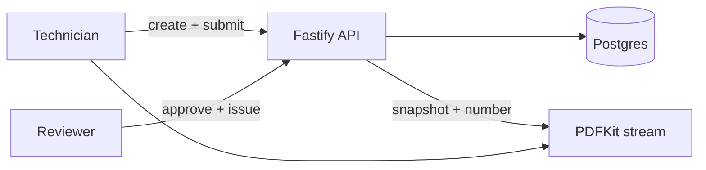

# Architecture

- `tickets` holds the state machine; `ticket_items` holds integer-cent lines.
- `review` and `submit` lock the row (`FOR UPDATE`) before checking the transition.
- `issueInvoice` runs in one transaction: lock ticket, reject if already invoiced, read items and
  client, increment `invoice_counters` for the org, insert the invoice with a JSON snapshot, update
  the ticket, append the audit entry. The unique `ticket_id` constraint is the final guard.
- The PDF is rendered from the snapshot only, never from live client data.
